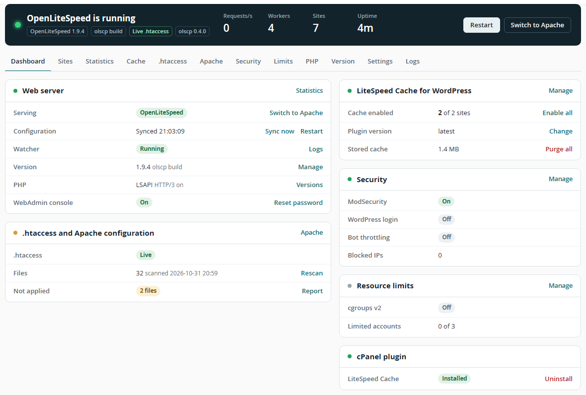
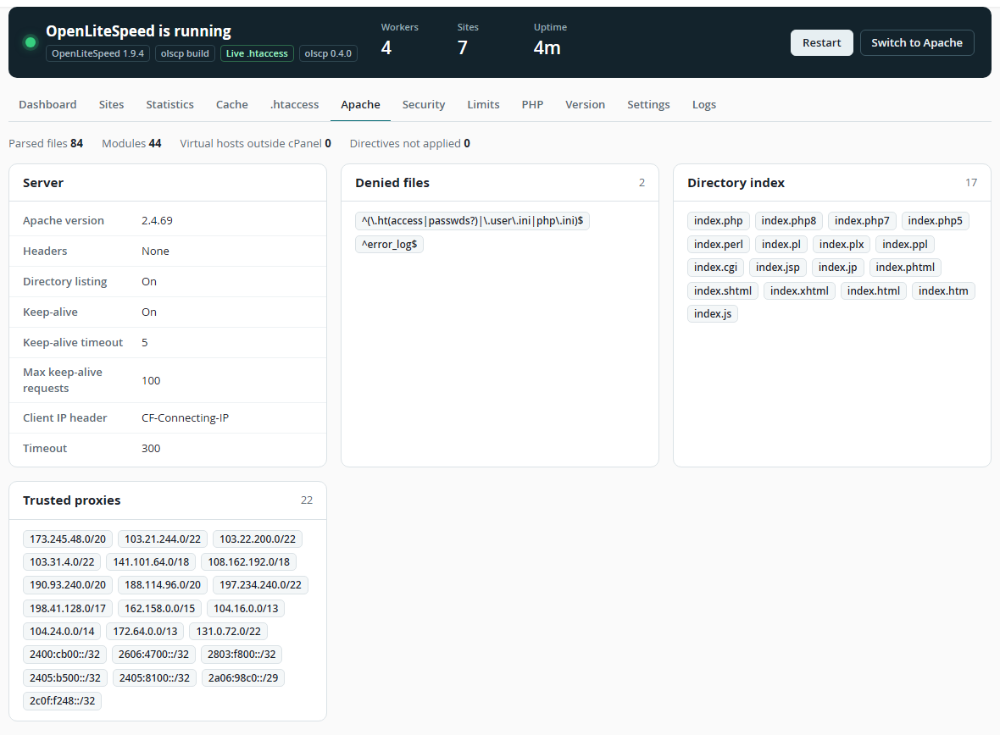
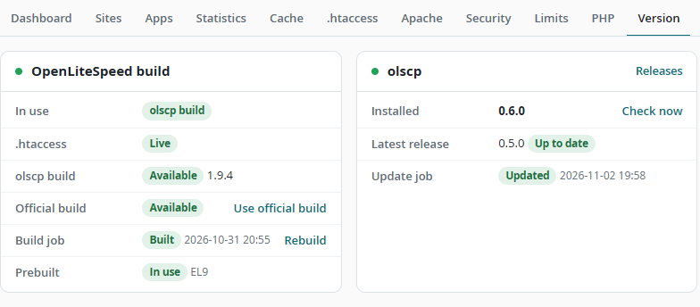
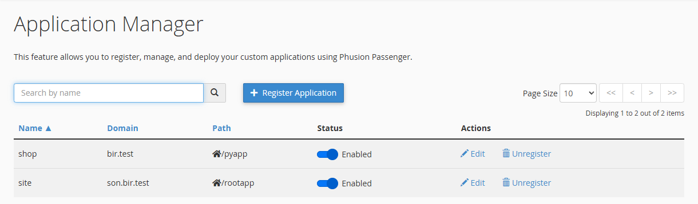
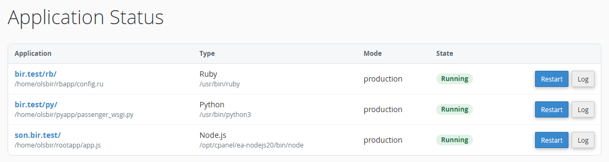
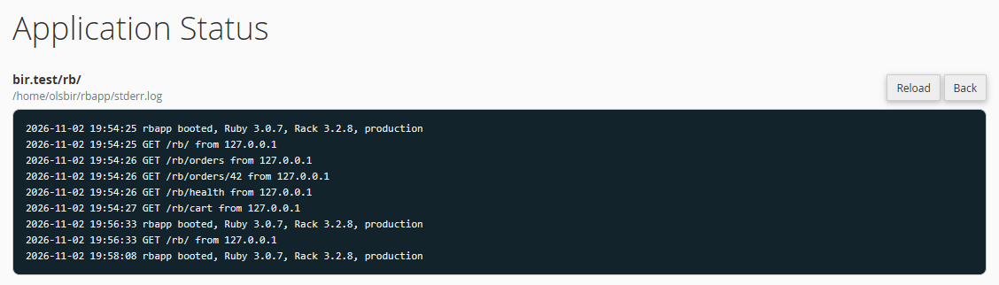
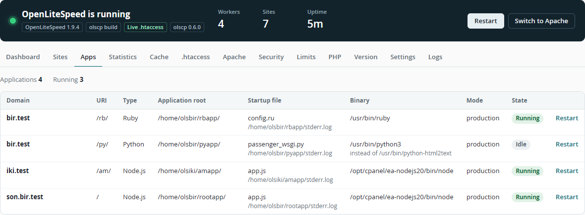

[English](../../README.md) | [Türkçe](README.tr.md) | [简体中文](README.zh-CN.md) | [Español](README.es.md) | [Português](README.pt-BR.md) | [Русский](README.ru.md) | [日本語](README.ja.md) | [Deutsch](README.de.md) | [Français](README.fr.md) | [한국어](README.ko.md) | **Bahasa Indonesia**

# OpenLiteSpeed for cPanel and WHM

Situs web: [openlitespeed.dev/cpanel-whm](https://openlitespeed.dev/cpanel-whm/)

Dengan **olscp**, Anda bisa memakai OpenLiteSpeed untuk cPanel: olscp menjalankan [OpenLiteSpeed](https://openlitespeed.org) di server cPanel/WHM sebagai pengganti langsung Apache. olscp membaca konfigurasi Apache yang ada dan data akun cPanel, membuat konfigurasi OpenLiteSpeed, menjaganya tetap sinkron secara otomatis, dan menambahkan plugin WHM serta plugin cPanel untuk mengelola semuanya. Gratis dan open source di bawah lisensi GPL-3.0.



## Fitur

- Bekerja dengan cPanel apa adanya: akun, addon domain, subdomain dan parked domain, AutoSSL, penangguhan akun, MultiPHP, `restartsrv_httpd`, chkservd, dan pembaruan EasyApache
- Peralihan yang aman: setelah beralih, setiap situs diperiksa lewat HTTP dan HTTPS, dan server otomatis kembali ke Apache jika ada situs yang berjalan di Apache gagal di OpenLiteSpeed. Dry run lebih dulu memeriksa setiap situs di port pratinjau sementara Apache tetap melayani
- Membaca `httpd.conf` dan semua file include, sehingga pengaturan Apache kustom dan virtual host tambahan ikut terbawa
- Dukungan `.htaccess`: aturan rewrite, Directory Privacy, Require/Allow/Deny, header, expires, redirect, halaman error, tipe MIME, pemblokiran bot dengan `SetEnvIf`, `php_value`, header cache di `<FilesMatch>` (WP Rocket, W3 Total Cache), dan versi PHP berbeda per direktori
- `.htaccess` langsung: perubahan rewrite berlaku dalam satu detik tanpa restart, dengan binary yang sudah di-patch dan dikompilasi sebelumnya atau yang dikompilasi di server
- PHP melalui pool PHP-FPM cPanel atau LSAPI per akun, dalam mode detached sehingga OPcache tetap terjaga saat restart
- Aplikasi Node.js, Python, dan Ruby dari cPanel Application Manager dan selector CloudLinux, dijalankan oleh OpenLiteSpeed sebagai pengguna akun
- CloudLinux LVE dan CageFS untuk PHP dan aplikasi, jika diaktifkan
- LSCache dengan penyimpanan per situs, pengelolaan cache WordPress, dan plugin cPanel untuk pengguna akhir
- ModSecurity dengan set aturan cPanel/OWASP
- Perlindungan brute-force WordPress, pembatasan laju bot, dan batas sumber daya cgroups v2 per pengguna atau paket
- HTTP/3 (QUIC) dengan daftar domain yang dinonaktifkan, Brotli, IPv6, statistik real-time dengan rasio cache hit dan penggunaan pool aplikasi, serta mode pratinjau di port 8080/8443
- Pembaruan sekali klik dari plugin WHM

## Persyaratan

- cPanel & WHM 11.130 atau lebih baru
- AlmaLinux, Rocky Linux, atau CloudLinux 8 atau 9, x86_64
- Versi PHP EasyApache 4

## Instalasi

```bash
git clone https://github.com/NeuralFoundry/openlitespeed-cpanel.git
cd openlitespeed-cpanel
bash install.sh
```

Installer mengunduh OpenLiteSpeed dari repositori resmi LiteSpeed, memverifikasinya dengan kunci GPG yang dipatok di `keys/`, memasang `lsphp` untuk setiap versi PHP EasyApache, dan mendaftarkan plugin WHM. Apache tetap melayani sampai Anda beralih.

1. Dry run opsional: klik **Dry run** di dashboard atau jalankan `olscp dry-run`. OpenLiteSpeed berjalan di port 8080/8443 dan setiap situs diperiksa sementara Apache tetap melayani; Anda bisa melihat situs mana saja yang akan rusak, jika ada.
2. Beralih: buka **WHM > Plugins > OpenLiteSpeed** dan klik **Switch to OpenLiteSpeed**, atau jalankan `olscp enable`. Setiap situs diperiksa setelah peralihan dan server otomatis kembali ke Apache jika ada situs yang berjalan di Apache gagal. Gunakan `olscp enable --no-rollback` untuk tetap memakai OpenLiteSpeed meskipun beberapa situs gagal.
3. Untuk kembali ke Apache kapan saja: `olscp disable`.

Server yang tidak bisa menjangkau `rpms.litespeedtech.com` dapat memasang dari paket lokal:

```bash
OLSCP_OLS_RPM=/root/openlitespeed-1.9.4-2.el9.x86_64.rpm bash install.sh
```

## .htaccess langsung

Binary OpenLiteSpeed bawaan hanya memuat aturan rewrite `.htaccess` satu kali. olscp menyertakan patch kecil (`build/patches/`) yang memuat ulang aturan rewrite yang berubah dalam satu detik dan mendeteksi file `.htaccess` baru pada request pertama, tanpa restart. Direktif lain diterapkan otomatis dengan graceful restart.

Setiap rilis menyertakan binary yang sudah di-patch untuk EL8 dan EL9. olscp mengunduhnya dari rilis, memeriksanya dengan SHA-256 di `build/prebuilt.txt`, lalu beralih ke binary tersebut:

```bash
olscp ols fetch --use  # download the prebuilt binary and switch to it
olscp ols build        # or compile it on the server in the background, about 10 minutes
olscp ols use olscp    # switch to a compiled build, "olscp ols use official" switches back
```

Kompilasi memasang toolchain dengan `dnf` dan mengambil source OpenLiteSpeed dari GitHub pada commit yang dipatok. Untuk mendapatkan binary siap pakai saat instalasi, jalankan `OLSCP_FETCH_OLS=1 bash install.sh`. Aksi yang sama tersedia di halaman **Version** plugin WHM.



## Pembaruan

Halaman **Version** plugin WHM menampilkan rilis terbaru dan memperbarui olscp dengan sekali klik. Pembaruan mengunduh rilis dari GitHub, menjalankan installer-nya, dan memuat ulang OpenLiteSpeed secara graceful. Binary siap pakai yang sebelumnya diunduh olscp diganti dengan binary dari rilis baru.



```bash
olscp update check     # look for a new release
olscp update start     # update in the background, log in /var/log/olscp-update.log
```

## Baris perintah

| Perintah | Keterangan |
|---|---|
| `olscp status` | Status server, watcher, dan sinkronisasi |
| `olscp enable` / `olscp disable` | Beralih ke OpenLiteSpeed / kembali ke Apache |
| `olscp restart` | Membuat ulang konfigurasi dan restart secara graceful |
| `olscp apache report` | Pengaturan yang dibaca dari konfigurasi Apache |
| `olscp htaccess report` | Direktif `.htaccess` yang tidak dapat diterapkan |
| `olscp apps` / `olscp apps restart --vhost example.com --uri /` | Aplikasi Node.js, Python, dan Ruby / restart salah satunya |
| `olscp cache list` / `olscp cache purge --all` | Situs LSCache / purge cache |
| `olscp ols versions` / `olscp ols upgrade` | Versi OpenLiteSpeed dan upgrade |
| `olscp ols fetch --use` | Mengunduh binary siap pakai dengan `.htaccess` langsung dan memakainya |
| `olscp update check` / `olscp update start` | Mencari rilis olscp baru / memperbarui |
| `olscp settings key=value --apply` | Mengubah pengaturan |

## Aplikasi Node.js, Python, dan Ruby

olscp membaca pengaturan Passenger yang ditulis cPanel Application Manager ke konfigurasi Apache dan yang ditulis selector Node.js dan Python CloudLinux ke `.htaccess`: `PassengerAppRoot`, `PassengerBaseURI`, `PassengerAppType`, `PassengerStartupFile`, `PassengerNodejs`, `PassengerPython`, `PassengerRuby`, `PassengerAppEnv`, `PassengerAppLogFile`, dan `SetEnv`. Setiap aplikasi berjalan sebagai pengguna akun, dijalankan pada request pertama, dan tetap berjalan saat server di-restart.

Pelanggan tetap memakai **cPanel > Application Manager** untuk mendaftarkan aplikasi mereka:



**cPanel > Application Status** menampilkan aplikasi milik pelanggan sendiri, me-restart aplikasi tersebut, dan menampilkan log-nya:





Halaman **Apps** plugin WHM menampilkan daftar aplikasi dari setiap akun beserta status, interpreter, file log, dan tombol restart:



- Aplikasi Node.js berjalan melalui starter Node.js OpenLiteSpeed. Panggilan ke `listen()` dialihkan ke socket yang diberikan OpenLiteSpeed kepada aplikasi.
- Aplikasi Python berjalan melalui `libexec/lswsgi.py`, server WSGI kecil yang bekerja dengan interpreter atau virtual environment Python 3.6 atau lebih baru. File startup harus mendefinisikan `application` (default `passenger_wsgi.py`).
- Aplikasi Ruby berjalan melalui `libexec/lsrack.rb`, server Rack kecil untuk Ruby 2.5 atau lebih baru. Server ini memuat `config.ru` dengan Bundler jika aplikasi memiliki `Gemfile`, sehingga `bundle install` dengan path lokal berfungsi. Gem `rack` harus terpasang untuk aplikasi. `RACK_ENV` dan `RAILS_ENV` mengikuti `PassengerAppEnv`.
- Untuk me-restart aplikasi, lakukan touch pada `tmp/restart.txt` di root aplikasi, atau gunakan **cPanel > Application Status** atau **WHM > Plugins > OpenLiteSpeed > Apps**. Pengaturan yang berubah me-restart aplikasi secara otomatis.
- Output ditulis ke `stderr.log` di root aplikasi, atau ke `PassengerAppLogFile` jika file tersebut berada di dalam direktori home.
- Subdirektori document root di bawah URI aplikasi disajikan sebagai file statis, sama seperti Passenger. `/.well-known/` tetap bisa diakses untuk AutoSSL.
- Jenis aplikasi ditentukan dari file startup (`passenger_wsgi.py`, `app.js`, atau `config.ru`) kecuali `PassengerAppType` diatur. Path interpreter yang tidak mengarah ke Node.js, Python, atau Ruby diganti dengan interpreter sistem.
- Root aplikasi harus berada di dalam direktori home akun. Jika konfigurasi Apache berisi `PassengerDisableHtaccess on`, yang merupakan default cPanel, pengaturan Passenger di `.htaccess` diabaikan.

## Versi PHP per direktori

MultiPHP menulis versi PHP sebuah domain ke `.htaccess` sebagai `AddHandler application/x-httpd-ea-phpXX`. Jika sebuah subdirektori memakai versi yang berbeda dari domainnya, olscp memetakan file PHP di direktori itu ke proses LSAPI versi tersebut untuk akun yang bersangkutan, sehingga versinya berlaku seperti di Apache. Ini membutuhkan mode PHP LSAPI dan paket LSAPI untuk versi tersebut, keduanya ada di halaman **PHP** plugin WHM.

## Header cache di FilesMatch

Plugin cache seperti WP Rocket dan W3 Total Cache menulis blok `<FilesMatch>` ke `.htaccess` yang hanya mengatur header atau waktu kedaluwarsa untuk beberapa tipe file. olscp mengubah setiap blok menjadi context regex yang mempertahankan aturan akses, pengaturan PHP, dan aturan rewrite dari direktorinya, sehingga request ke `sitemap.xml` yang tidak ada tetap sampai ke WordPress dan direktori yang dilindungi tetap terlindungi.

## CloudLinux

Di CloudLinux, OpenLiteSpeed dapat menjalankan PHP dan aplikasi di dalam LVE akun dan, jika CageFS terpasang, di dalam CageFS akun tersebut. Fitur ini nonaktif secara default; dashboard menampilkan keterangan saat CloudLinux terdeteksi. Aktifkan di **Settings > CloudLinux** (Auto, LVE, LVE and CageFS) atau dengan `olscp settings cloudlinux=auto --apply`. olscp menambahkan file miliknya ke CageFS dengan `/etc/cagefs/conf.d/olscp.cfg`, menjalankan `cagefsctl --update`, dan me-restart proses PHP dan aplikasi. Setelah itu batas sumber daya berasal dari LVE Manager dan batas cgroups v2 dari olscp dinonaktifkan.

## Uninstal

```bash
bash uninstall.sh          # switch back to Apache, remove the plugins and services
bash uninstall.sh --purge  # also delete /usr/local/olscp, settings, cache and logs
```

## Keterbatasan

- Tidak diterjemahkan dari `.htaccess`: `<If>`, `Require host/expr`, `AuthType Digest`, serta blok `<FilesMatch>` yang mengatur lebih dari header dan waktu kedaluwarsa.
- Aplikasi Ruby tidak dapat memakai WebSocket atau `rack.hijack`.
- Dukungan CloudLinux memakai hook LVE dan CageFS bawaan OpenLiteSpeed. Dukungan ini diuji dengan pengganti `liblve`, belum di server CloudLinux berlisensi.
- Daftar isi direktori tidak tersedia untuk situs yang memakai PHP-FPM, karena pool FPM cPanel membatasi `doc_root`. Fitur ini berfungsi dengan LSAPI.
- Klien tanpa SNI di IP dedicated menerima sertifikat server.
- Arsip rilis tidak ditandatangani. Pembaruan mengandalkan koneksi HTTPS ke GitHub; binary siap pakai juga diperiksa dengan SHA-256 di `build/prebuilt.txt`.

## Kontribusi

Laporan bug dan pull request dipersilakan, lihat [CONTRIBUTING.md](../../CONTRIBUTING.md). Laporkan masalah keamanan secara privat seperti dijelaskan di [SECURITY.md](../../SECURITY.md).

## Lisensi

GPL-3.0, lihat [LICENSE](../../LICENSE). OpenLiteSpeed dikembangkan oleh LiteSpeed Technologies dan dilisensikan di bawah GPL-3.0; patch di `build/patches/` didistribusikan dengan lisensi yang sama. Proyek ini tidak berafiliasi dengan atau didukung oleh LiteSpeed Technologies maupun cPanel, L.L.C. LiteSpeed, OpenLiteSpeed, LSCache, cPanel, dan WHM adalah merek dagang dari pemiliknya masing-masing.

Juga dari penulis yang sama: [OpenLiteSpeed for Windows](https://github.com/NeuralFoundry/openlitespeed-windows), build native OpenLiteSpeed untuk Windows.
